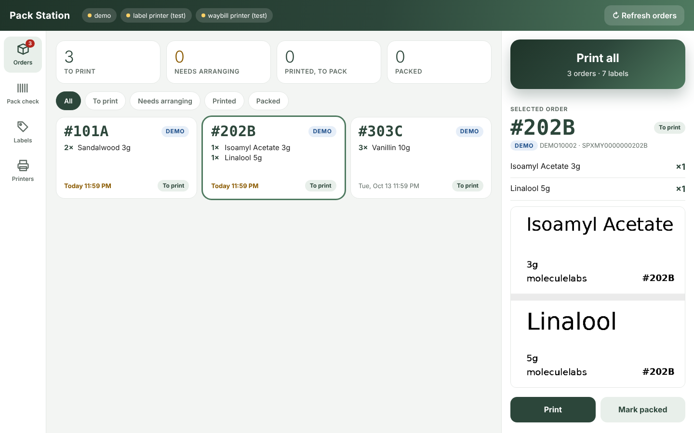

# atlasdsf

## Pack Station: one-click waybills and product labels

A touch-friendly station for the packing Mac (it also works on an iPad or phone on the same
Wi-Fi). It scans Shopee, TikTok Shop and Odoo for orders that are ready to pack, and does
everything from one screen:

- **Orders:** every order as a card with its match code, items, ship-by time (amber = today,
  red = late) and status. Tap the tiles to filter: To print, Needs arranging, Printed, Packed.
  **Print all** prints every pending order with a progress bar: for each order, its **waybill**
  on the waybill printer, then its **product labels** (one per unit) on the label printer, in
  the same order. Tap a card to preview its labels, print or reprint it, or mark it packed.
- **Pack check:** scan the waybill (any USB barcode scanner works), or type the order number or
  `#code`. The order's items show as big tiles; tap each one as it goes in. The order is only
  marked packed once every item is ticked, with a beep for right and wrong.
- **Labels:** the product label list, editable on screen with a live preview of each label,
  plus a test print per product.
- **Printers:** what each printer is set to, with test-print buttons.

Every product label carries a **match code**: the last 4 characters of the tracking number,
which is printed on the waybill too (for example `#871A`). Orders are remembered once printed,
so Print all never prints anything twice.



### Start it

Double-click `scripts/start-mac.command`. The first run installs what it needs (Python 3 comes
with macOS developer tools; run `xcode-select --install` once if it's missing). Then it opens
http://localhost:8765. Use the browser's full-screen mode for a kiosk feel. It starts in **demo mode**: made-up orders, and "printing" just saves
files into `data/output/`, so you can try it safely.

Terminal alternatives: `python -m packstation scan` lists what it finds;
`python -m packstation print-all` prints without the page; `python -m packstation test-label`
prints one sample product label.

### Set it up for real: `config.toml`

`config.toml` holds your keys and is never committed. The first start creates it from
`config.example.toml`.

| Section | What to fill in |
|---|---|
| `[shopee]` | Shopee Open Platform app `partner_id` and `partner_key`, `shop_id`, and the first `access_token` and `refresh_token` from authorising your shop. Tokens refresh automatically after that. |
| `[tiktok]` | TikTok Shop Partner Center `app_key`, `app_secret`, `shop_cipher` and tokens. |
| `[odoo]` | URL, database, a user's login and an **API key** (Odoo: Preferences → Account Security → New API Key). `platform_ref_field` is the sale order field where your connector stores the Shopee/TikTok order number. |
| `arrange` | Shopee and TikTok only issue a waybill once shipment is arranged. `"off"` (default) means you arrange it in Seller Centre first, and those orders show **needs arranging**. Set `"dropoff"` or `"pickup"` to let Print all arrange it. |

Set `enabled = true` on each source you fill in, and `[demo] enabled = false`.

Odoo deliveries that belong to a Shopee or TikTok order are merged with that order, and Odoo gets
a "printed" note on the delivery. Odoo-only orders (for example WhatsApp sales) print product
labels only.

### Product labels: `labels/products.csv`

One row per product. This file is the master list, kept in git so it's backed up and editable
from GitHub:

```
sku,title,size,brand,icon
ML-SANDAL-3G,Sandalwood,3g,moleculelabs,corrosive
```

`sku` must match the SKU on Shopee, TikTok and Odoo. `icon` is a PNG in `assets/icons/`, or
leave it empty. Products missing from the list still print: the title and size are taken from
the marketplace name, and the print summary flags them so you can add them. The **label** link
on each order previews its labels.

### Printers (AiYin E40 Pro, without Label Expert)

Each printer in `config.toml` has a `backend`:

- `file`: test mode, saves to `data/output/` (default)
- `tspl`: sends label commands straight to the printer over USB, with no driver and no Label Expert
- `bluetooth`: the same, over Bluetooth (no pairing needed). Slower: a big waybill takes around
  15 to 25 seconds. Close Label Expert on your phone first; a printer talks to one device at a time
- `cups`: an ordinary macOS printer queue, if a working driver exists

To set up the printers (Bluetooth or USB), switch them on and run:

```
bash scripts/setup-printers-mac.command
```

It finds the printers, connects them, prints a big test number on each, asks which printer is
which (and whether the print came out the right way round), and saves the settings in
`config.toml`. If a printer doesn't accept direct printing, it stops without changing anything.

### Tests

```
python -m venv .venv && .venv/bin/pip install -r requirements.txt pytest
.venv/bin/python -m pytest -q
```
